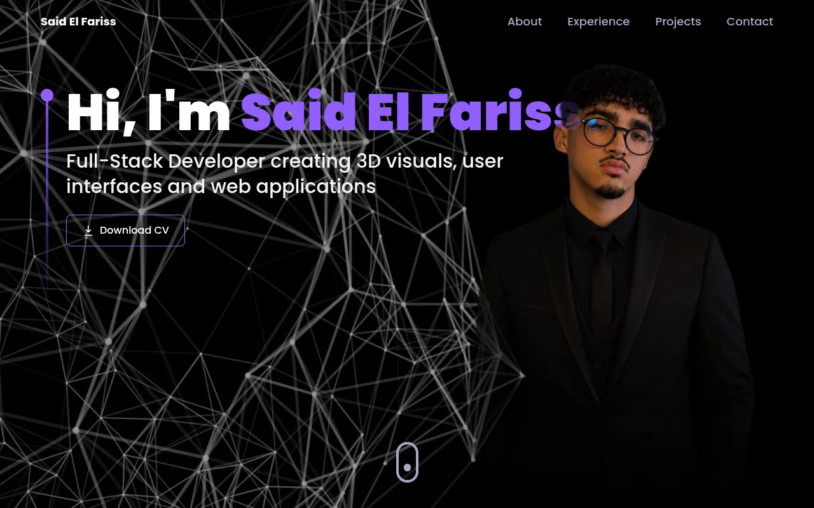

<a name="readme-top"></a>
<div align="center">

  <h1>Said El Fariss — Full-Stack Web Developer</h1>

  <p>
    My personal portfolio website, built with React, Three.js and Tailwind CSS.
  </p>

<p>
  <a href="https://github.com/ElFarisssaid19">
    
  </a>
  <a href="LICENSE">
    
  </a>
</p>

<!-- TODO: add the live site URL -->

</div>

<div align="center">
  
</div>

## About

I'm Said El Fariss, a full-stack web development student at Centre de BTS de Chichaoua, Morocco. This site presents my experience, education, projects and contact details.

Sections: Hero, Overview, Experience & Education, Technologies, Projects, Services and Contact.

## Tech Stack

- [React 18](https://react.dev/) + [Vite 8](https://vitejs.dev/)
- [Three.js](https://threejs.org/) with [React Three Fiber](https://docs.pmnd.rs/react-three-fiber) and [Drei](https://github.com/pmndrs/drei)
- [Tailwind CSS](https://tailwindcss.com/)
- [Framer Motion](https://www.framer.com/motion/)
- [EmailJS](https://www.emailjs.com/) for the contact form

## Folder Structure

```bash
Said-El-Fariss-3d-portfolio/
|- public/            # static files: 3D models, images, video, CV
|- readme_assets/
|- src/
  |-- assets/         # icons and images imported by components
  |-- components/     # page sections
    |--- canvas/      # Three.js scenes (tech balls, Earth, stars)
  |-- constants/      # site content: experience, projects, technologies...
  |-- hoc/            # section wrapper
  |-- utils/          # animation variants
  |-- App.jsx
  |-- index.css
  |-- main.jsx
  |-- styles.js
|- index.html
|- postcss.config.cjs
|- tailwind.config.cjs
|- vite.config.js
```

Most of the site content lives in [`src/constants/index.js`](src/constants/index.js).

## Getting Started

Requirements: [Node.js](https://nodejs.org/) 20.19+ or 22.12+ and npm.

1. Clone the repository and install the dependencies:

   ```bash
   git clone https://github.com/ElFarisssaid19/Said-El-Fariss-3d-portfolio.git
   cd Said-El-Fariss-3d-portfolio
   npm install
   ```

2. Copy `.env.example` to `.env` and fill in your own [EmailJS](https://www.emailjs.com/) credentials and contact details (needed for the contact form):

   ```bash
   cp .env.example .env
   ```

3. Start the development server:

   ```bash
   npm run dev
   ```

4. Build and preview the production version:

   ```bash
   npm run build
   npm run preview
   ```

## Deployment

Two optional environment variables are read at build time:

| Variable    | Default                  | Purpose |
|-------------|--------------------------|---------|
| `SITE_URL`  | `https://TODO-SITE-URL`  | Public URL of the site, used for the canonical link and the Open Graph / Twitter tags. Include the sub-path on GitHub Pages. |
| `BASE_PATH` | `/`                      | Path the site is served from. Keep `/` on Vercel or a custom domain; use `/<repo>/` for a GitHub Pages project site. |

```bash
# Vercel / custom domain
SITE_URL=https://your-domain.com npm run build

# GitHub Pages project site
SITE_URL=https://elfarisssaid19.github.io/Said-El-Fariss-3d-portfolio \
BASE_PATH=/Said-El-Fariss-3d-portfolio/ npm run build
```

## Credits

- Based on the Three.js portfolio tutorial by [JavaScript Mastery](https://github.com/adrianhajdin), through [Soufain Najmi's version of the template](https://github.com/SoufainNajmi/Threejs-3D-Portfolio-main).
- 3D models (licensed under [CC-BY-4.0](http://creativecommons.org/licenses/by/4.0/)):
  - "[Stylized planet](https://sketchfab.com/3d-models/stylized-planet-789725db86f547fc9163b00f302c3e70)" by [cmzw](https://sketchfab.com/cmzw), used in the Contact section.
  - "[Gaming Desktop PC](https://sketchfab.com/3d-models/gaming-desktop-pc-d1d8282c9916438091f11aeb28787b66)" by [Yolala1232](https://sketchfab.com/Yolala1232), used in earlier versions of the site.
- Technology icons for Bootstrap, Next.js and Three.js from [Simple Icons](https://simpleicons.org/) (CC0); PHP, MySQL and Linux (Tux) icons from [Devicon](https://devicon.dev/) (MIT).

## License

Distributed under the MIT License. See [LICENSE](LICENSE) for more information.

## Contact

Said El Fariss — [said.elfariss.dev@gmail.com](mailto:said.elfariss.dev@gmail.com) — [GitHub](https://github.com/ElFarisssaid19)

<p align="right">(<a href="#readme-top">back to top</a>)</p>
