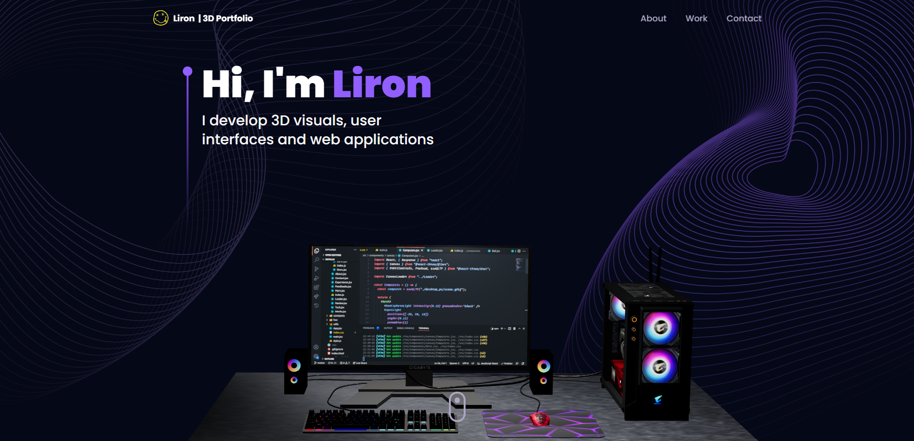
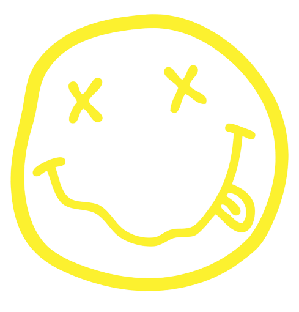

<a name="readme-top"></a>
<div align="center">

  <h1>Portfolio 3D — Said El Fariss</h1>

  <p>
    Portfolio développeur interactif en 3D, construit avec React & Three.js
  </p>

<!-- Badges -->
<p>
  <a href="https://github.com/ElFarisssaid19">
    
  </a>
  <a href="LICENSE">
    
  </a>
</p>

 <h4>
    <a href="https://github.com/ElFarisssaid19">GitHub</a>
  </h4>
</div>

<br />

<!-- Table of Contents -->
<details>

<summary>

# :notebook_with_decorative_cover: Table of Contents

</summary>

- [About the Project](#star2-about-the-project)
  * [Folder Structure](#bangbang-folder-structure)
  * [Tech Stack](#space_invader-tech-stack)
- [Getting Started](#toolbox-getting-started)
  * [Installation](#gear-installation)
  * [Run Locally](#running-run-locally)
- [Contributing](#wave-contributing)
- [License](#warning-license)
- [Contact](#handshake-contact)
- [Acknowledgements](#gem-acknowledgements)

</details>

<!-- About the Project -->
## :star2: About the Project

<div align="center">
  
</div>

<br />

Portfolio personnel de Said El Fariss, étudiant en BTS Développement Web Full Stack (Centre de BTS de Chichaoua, OFPPT). Ce site présente mon parcours, mon expérience de stage et mes projets, à travers des sections Navbar, Hero, Overview, Expérience, Technologies, Projets, Témoignages et Contact, construites avec React & Three.js et TailwindCSS ⏭

<!-- Folder Structure -->
### :bangbang: Folder Structure

Here is the folder structure of 3D-Portfolio.
```bash
Threejs_3D_Portfolio/
|- public/
|- src/
  |-- assets/
  |-- components/
  |-- constants/
  |-- hoc/
  |-- utils/
  |-- App.jsx
  |-- index.css
  |-- main.jsx
  |-- styles.js
|- postcss.config.cjs
|- tailwind.config.cjs
|- vite.config.js
```
<br />

<!-- TechStack -->
### :space_invader: Tech Stack

[](https://skillicons.dev)

<p align="right">(<a href="#readme-top">back to top</a>)</p>

<!-- Getting Started -->
## :toolbox: Getting Started

<!-- Installation -->
### :gear: Installation

#### Step 1:
Clone this repository.

#### Step 2:

3D-Portfolio using NPM (Node Package Manager), therefore, make sure that Node.js is installed by execute the following command in console:

```bash
  node -v
```

#### Step 3:

At the main folder execute the following command in console to get the required dependencies:

```bash
  npm install
```

#### Step 4:

At the main folder execute the following command in console to creates a build directory with a production build of 3d portfolio:

```bash
  npm run build
```

#### Step 5:

At the main folder execute the following command in console to preview the production build:

```bash
  npm run preview
```

<!-- Run Locally -->
### :running: Run Locally

#### Step 1:

At the main folder execute the following command in console to get the required dependencies:

```bash
  npm install
```

#### Step 2:

Copy `.env.example` to `.env` and fill in your own [EmailJS](https://www.emailjs.com/) credentials and contact email (needed for the Contact form):

```bash
  cp .env.example .env
```

#### Step 3:

At the main folder execute the following command in console to run the development server:

```bash
  npm run dev
```

<p align="right">(<a href="#readme-top">back to top</a>)</p>

<!-- Contributing -->
## :wave: Contributing

<a href="https://github.com/ElFarisssaid19">
  
</a>


Contributions are always welcome!

See [`contributing.md`](https://contributing.md/) for ways to get started.

Contributions are what make the open source community such an amazing place to learn, inspire, and create. Any contributions you make are **greatly appreciated**.

If you have a suggestion that would make this better, please fork the repo and create a pull request. You can also simply open an issue with the tag "enhancement".
Don't forget to give the project a star! Thanks again!

1. Fork the Project
2. Create your Feature Branch (`git checkout -b feature/AmazingFeature`)
3. Commit your Changes (`git commit -m 'Add some AmazingFeature'`)
4. Push to the Branch (`git push origin feature/AmazingFeature`)
5. Open a Pull Request

<p align="right">(<a href="#readme-top">back to top</a>)</p>

<!-- License -->
## :warning: License

Distributed under the MIT License. See [LICENSE](LICENSE) for more information.

<p align="right">(<a href="#readme-top">back to top</a>)</p>

<!-- Contact -->
## :handshake: Contact

Said El Fariss - [GitHub](https://github.com/ElFarisssaid19)

<p align="right">(<a href="#readme-top">back to top</a>)</p>

<!-- Acknowledgments -->
## :gem: Acknowledgements

This section used to mention useful resources and libraries that used in 3D Portfolio

 - [Email JS](https://www.emailjs.com/)
 - [Framer Motion](https://www.framer.com/motion/)
 - [React Tilt](https://www.npmjs.com/package/react-tilt)
 - [React Vertical Timeline Component](https://www.npmjs.com/package/react-vertical-timeline-component)
 - #JSMastery
 - Based on the [Threejs 3D Portfolio](https://github.com/SoufainNajmi/Threejs-3D-Portfolio-main) template

<p align="right">(<a href="#readme-top">back to top</a>)</p>

<p align="center">

</p>
